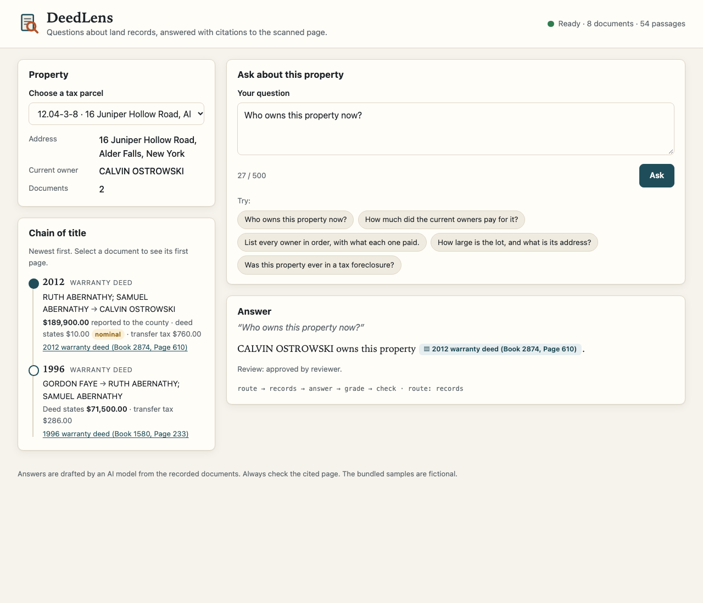
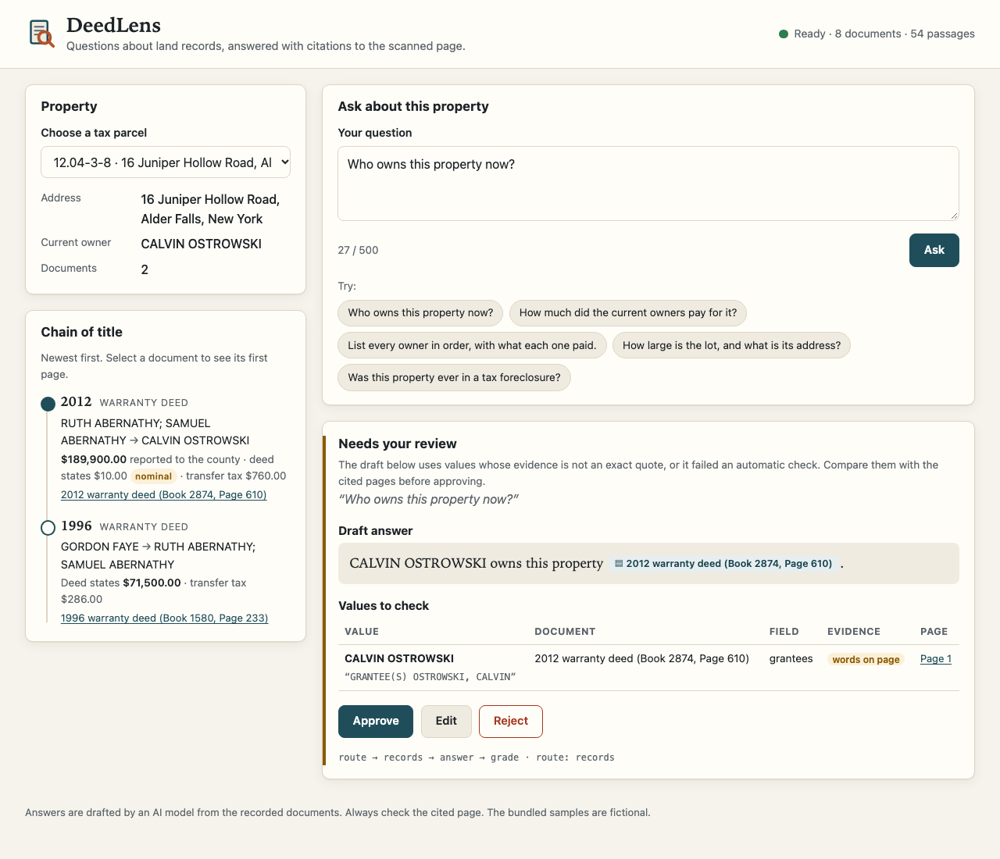
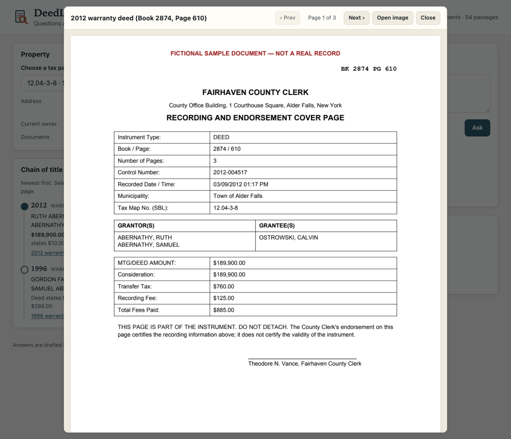
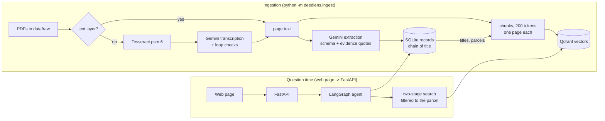
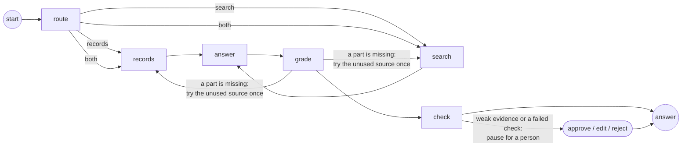

# DeedLens

Ask plain-English questions about recorded land documents (deeds, cover pages, court judgments)
and get answers that cite the exact scanned page. DeedLens reads scanned PDFs, extracts a
structured record of each document, links them into a chain of title, and answers with an agent
that searches only the selected property, checks its own draft, and asks a person to review
anything it can't back with an exact quote.



| Review before answering | Click a citation to see the page |
|---|---|
|  |  |

> The bundled documents are **fictional** (Fairhaven County, New York, does not exist). Every page
> carries the banner "FICTIONAL SAMPLE DOCUMENT — NOT A REAL RECORD".

## Quick start (Docker)

```bash
git clone https://github.com/Abhijeet-Saich/deed-lens.git && cd deed-lens
cp .env.example .env          # paste your own GEMINI_API_KEY (free at https://aistudio.google.com)
docker compose up             # builds, ingests the fictional sample deeds, starts the server
# open http://localhost:8000
```

What to expect on the first run:

- The image build downloads CPU-only PyTorch and the Python dependencies (a few minutes, once).
- The container downloads the embedding and reranking models (~250 MB, cached in a Docker volume).
- It ingests the 8 sample PDFs: about 12 Gemini calls (4 scanned pages transcribed, 8 documents
  extracted), spaced 4 seconds apart for the free tier. Later starts reuse the cache and take seconds.
- Each question then takes roughly 5–20 seconds and 3–5 Gemini calls.

Without a key the app still starts, in **search-only mode**: Tesseract OCR and search work, but no
records are extracted and questions can't be answered. The page says so at the top.

## Using your own PDFs

Put PDFs in `data/raw/` and restart the container (or run `make ingest` locally). Ingestion is
cached by file hash, so only new or changed files cost anything. Then pick the parcel in the page.

**Privacy:** everything stays in `data/` on your machine, except the page images and text that are
sent to Google's Gemini API for transcription, extraction and answers. `data/` is git-ignored. Don't
commit real records.

## How it works



The agent:



More detail, including the data model, is in [docs/architecture.md](docs/architecture.md).

## Design decisions, with measured results

DeedLens was built lesson by lesson on a private set of real recorded documents (7 documents,
50 hand-checked facts, 12 answer-level test questions). Each rule below was kept because a
measurement supported it. **These numbers come from that private set, not from the fictional samples.**

| Decision | Measured on real records |
|---|---|
| Tesseract with `--psm 6` (one block) instead of the default layout mode; no image clean-up | 37 → 44 of 50 facts found (Otsu binarization made it worse) |
| Gemini vision transcription for scanned pages, with repetition-loop checks, one retry and Tesseract fallback | 50/50 facts; one page had looped into 41,920 characters of dashes before the checks |
| Tesseract confidence is never used as a quality signal | it ranked the OCR variants almost backwards |
| BMP temp images and `OMP_THREAD_LIMIT=1` for threaded OCR | OCR time 43.5 s → 16.8 s, identical output |
| Two-stage search: vector top 25 ∪ BM25 top 25, then a cross-encoder reranks; no Reciprocal Rank Fusion | MRR 0.58 (vector only) → 0.79 |
| Every search filtered to the selected parcel (vectors and BM25) | with look-alike neighbour deeds, true accuracy 4/12 → 9/12 |
| Keep both prices: the deed's (often nominal $1 / $10) and the clerk cover page's real one; label ≤ $10 as nominal | deeds state a token amount; the real price is only on the cover page used for transfer tax |
| Link documents by recording page *range*, not exact page | deeds cite the deed-text page, one after the cover page |
| Layered guardrails: prompt rules, an input scanner for instruction-like text, output checks on links, amounts, owner names and citations | prompt-injection success 5/5 → 0/5, normal accuracy 4/4 kept; scanner flagged 0 of 501 real chunks |
| Correctness checks use `must_include` **and** `must_not_include` | mixed-parcel answers scored "correct" (8/12) on the simple metric while only 4/12 were truly right |

On the fictional samples (`make eval`, one run) the agent answered 13/13 questions fully correctly
with no contamination and a faithfulness score of 1.00. The samples are clean and short, so treat
that as a smoke test, not as accuracy on real records.

## Evaluation

```bash
make eval                                    # = python -m eval.run_eval
python -m eval.run_eval --no-judge           # fewer API calls
python -m eval.run_eval --repeat 3           # answers vary between runs, even at temperature 0
python -m eval.run_eval --answers my_questions.json
```

Each question lists the facts an answer must contain (`must_include`, with alternatives) and values
it must not contain (`must_not_include`, for example a neighbouring parcel's acreage). The report shows:

- **correct**: share of required facts in the answer;
- **contaminated**: a forbidden value appeared;
- **in context**: share of required facts that reached the model, so a failure can be blamed on
  routing/retrieval (never reached it) or generation (reached it, not used);
- **faithful**: an LLM judge checks every claim against the source it cites. The judge must pass
  three known-verdict checks first, or its score is marked untrusted;
- retries, review pauses and seconds per question.

Results are saved under `data/results/`.

## Local development

```bash
python3.12 -m venv .venv && source .venv/bin/activate
pip install -e ".[dev]"            # Intel Mac: run  pip install torch==2.2.2 "numpy<2"  first
brew install tesseract             # or: sudo apt-get install tesseract-ocr
cp .env.example .env               # add GEMINI_API_KEY
python -m deedlens.ingest --source samples
uvicorn deedlens.api.main:app --reload      # or: make serve
```

Newer PyTorch releases have no Intel-Mac wheels, so Intel Macs need the older pins shown above.

Other commands:

| Command | What it does |
|---|---|
| `make test` | unit tests: no API key, no network, no model downloads |
| `make lint` | `ruff check` |
| `make samples` | regenerate the fictional sample PDFs (deterministic) |
| `python -m deedlens.ingest --redo` | ignore every cache |
| `python -m deedlens.ingest --no-gemini` | Tesseract only, search-only mode |
| `python -m deedlens.agent "Who owns it now?" --parcel 12.04-3-7` | ask from the terminal |

Configuration lives in `.env` (see [.env.example](.env.example)).

## Limitations and next steps

- Tuned on one county's document formats (New York style book/page recording, clerk cover pages).
- Depends on Gemini for transcription, extraction and answers; there is no offline model option.
- The bundled samples are synthetic and much cleaner than real scans.
- Review is strict: any value whose evidence quote isn't an exact match pauses for a person. On the
  samples that is about half of all answers, mostly owner names quoted from cover-page tables.
- No authentication or multi-user support: run it locally or behind your own access control.
- Each question uses a few Gemini calls; there is no caching of answers.

## License and credits

MIT, see [LICENSE](LICENSE).

- Embeddings: [BAAI/bge-small-en-v1.5](https://huggingface.co/BAAI/bge-small-en-v1.5) (MIT)
- Reranker: [cross-encoder/ms-marco-MiniLM-L-6-v2](https://huggingface.co/cross-encoder/ms-marco-MiniLM-L-6-v2) (Apache-2.0)
- OCR: [Tesseract](https://github.com/tesseract-ocr/tesseract) (Apache-2.0); PDF rendering: [pypdfium2](https://github.com/pypdfium2-team/pypdfium2) (Apache-2.0 / BSD-3-Clause)
- LLM: Google Gemini via the Gemini API (subject to Google's terms)
- Built with LangChain, LangGraph, Qdrant, FastAPI and sentence-transformers.
