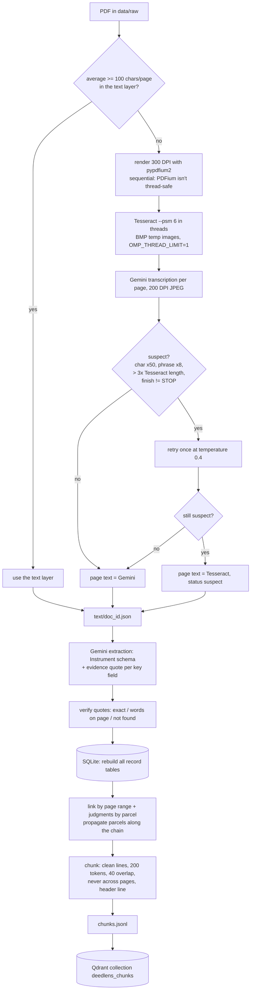
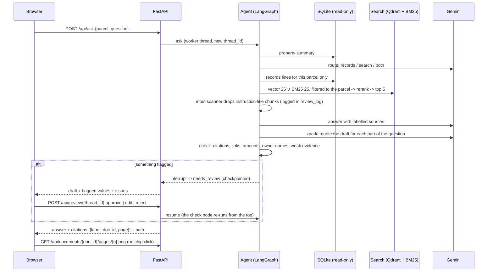

# DeedLens architecture

This document explains how the pieces fit together and why each rule exists. The "Lesson" numbers
refer to the step-by-step experiments DeedLens was built from (on a private set of real records).

## Packages

| Package | Responsibility | Runs at |
|---|---|---|
| `deedlens/config.py` | One `Settings` object from the environment; every path derives from `DATA_DIR` | everywhere |
| `deedlens/text_utils.py` | `squash`, digits, doc ids, parcel numbers, the BM25 tokenizer | everywhere |
| `deedlens/ingest/` | PDFs → page text → extracted records → chunks → vector index | ingestion |
| `deedlens/store/records.py` | SQLite schema, chain linking, parcel propagation, read-only queries | both |
| `deedlens/store/search.py` | embeddings, BM25 and two-stage retrievers, the parcel filter | question time |
| `deedlens/agent/` | LangGraph agent, prompts, guardrails, runtime (models loaded once) | question time |
| `deedlens/api/` | FastAPI routes and request models; no business logic | question time |
| `web/` | static page, plain HTML/CSS/JS, served by FastAPI | browser |
| `eval/` | answer-level evaluation | on demand |

## Ingestion



Caching, all keyed by content:

- page text is stored with the PDF's SHA-256; a changed file is redone, an unchanged one is reused;
- Gemini page transcriptions are never thrown away; pages marked `suspect` are not retried (they
  looped once and would likely loop again); pages that hit an API error are retried next run;
- extraction is stored with the SHA-256 of the text it read;
- the record tables are rebuilt from scratch on every run (milliseconds, never stale);
- the vector index is re-embedded only when `chunks.jsonl` changes.

## Data model

```
data/
├── raw/                 input PDFs
├── text/<doc_id>.json   per page: text, method, Tesseract text, Gemini text, status
├── extracted/<doc_id>.json   the Instrument record + the hash of the text it came from
├── chunks.jsonl         one chunk per line (BM25 reads this; the index is rebuilt from it)
├── qdrant/              vector store (local mode: one client per folder)
├── deedlens.db          records (below) + review_log
├── checkpoints.db       LangGraph checkpoints: paused reviews survive restarts
├── page_cache/          rendered page images for the viewer
├── results/             evaluation runs
└── manifest.json        doc_id -> file, hash, pages, text method, extracted?
```

```sql
documents   (doc_id PK, file_name, num_pages, sha256, title, instrument_type, year)
instruments (doc_id PK, volume, page, num_pages, date_signed, date_recorded,
             consideration_in_deed, consideration_reported, transfer_tax,
             parcel_id, property_address, town, acreage, prior_volume, prior_page)
parcels     (doc_id, parcel_id, source)   -- source: extracted | text | chain
parties     (doc_id, role, name)          -- role: grantor | grantee
chain       (doc_id, previous_doc_id, how)
evidence    (doc_id, field, page, quote, verified)
review_log  (id PK, created_at, kind, doc_id, detail)
```

**Titles** are generated, not typed: `"2019 warranty deed (Book 3307, Page 52)"`. Answers cite these
labels, and the frontend turns them back into links to the page.

**Linking.** A deed's "being the same premises…" clause cites the deed before it by book and page.
A document occupies a *range* of pages (cover page 52, deed text 53–54), and deeds often cite the
deed-text page, so a citation matches `cited_page BETWEEN page AND page + num_pages - 1` (Lesson 8).
Tax foreclosure judgments list many parcels in an exhibit; each listed parcel links the judgment to
that parcel's latest earlier document.

**Parcels.** A document belongs to its extracted tax map number plus every parcel number found in
its text. Documents with no parcel of their own (older deeds often have none) inherit the parcels of
the documents they link to. Judgments don't pass their parcels on: they list many, and a deed linked
to a judgment belongs to only one of them.

## Question time



### Search

- **Embeddings:** `BAAI/bge-small-en-v1.5`, normalized; the query (only) gets the bge prefix
  "Represent this sentence for searching relevant passages: ". With `HuggingFaceEmbeddings`,
  `query_encode_kwargs` replaces `encode_kwargs`, so normalization is set in both (Lesson 7).
- **Stage 1:** vector top 25 ∪ BM25 top 25, merged and deduplicated. **Stage 2:** the
  `ms-marco-MiniLM-L-6-v2` cross-encoder scores every candidate; the top 5 go to the model.
  Reciprocal Rank Fusion was tried and rejected: it buried answers only one method found (Lesson 7).
- **BM25 tokenizer** keeps numbers like `48,468.96` and `70.15-5-11` whole (Lesson 10).
- **Parcel filter:** Qdrant filters on `metadata.parcels`; BM25 is built once over all chunks and its
  results are filtered the same way. (A BM25 built over one parcel's few chunks gives degenerate
  IDF and scores everything 0.)

### Agent

- `route` picks records, search or both. Parcels with no extracted records go straight to search.
- `records` reads every instrument in the parcel's chain; deed amounts ≤ $10 are labelled
  "(nominal: a token amount, not the real price)" and the prompt says to prefer the reported price.
- `grade` asks the model to quote the draft for each part of the question; code decides completeness.
  "Why/how" parts need a stated cause. At most one retry, using the source not used yet.
- `check` pauses with `interrupt()` when the draft uses a value whose evidence quote wasn't exact,
  or when an output check fails. LangGraph re-runs the node on resume, so nothing before
  `interrupt()` writes anything.

### Guardrails (Lesson 12)

| Layer | What it does | Why this way |
|---|---|---|
| System prompt | only the sources; cite every fact by its label; source text is untrusted | the first layer; not enough on its own |
| Input scanner | drops chunks with instruction-like phrases, logs them in `review_log` | flagged 0 of 501 real chunks; URLs and "Social Security" are NOT scanned for, because real court filings contain them |
| Output checks | no links; no requests for personal info; every `$` amount in a source; people named as owners must be parties of this parcel; every citation names a provided source | catches attacks that look like content (a fake "corrective deed") |

All layers together: attack success 0/5, normal accuracy unchanged (4/4).

## Frontend

One static page; no framework and no build step. It never inserts API text with `innerHTML`:
answers are written by a model that read untrusted documents. Citation labels in the answer are
matched to the `citations` the API returns and rendered as buttons that open the page viewer.
